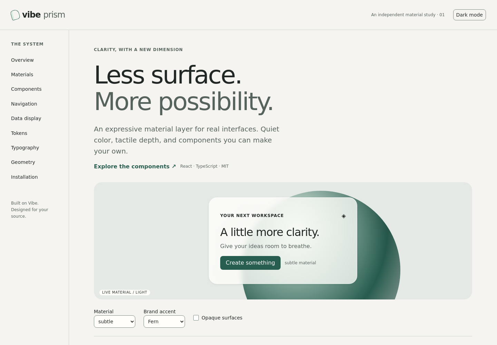

# Vibe Prism

An independent, source-first design-system fork of [monday.com Vibe](https://github.com/mondaycom/vibe). Prism adds warm editorial typography, scoped semantic themes and restrained glass materials while preserving Vibe’s existing component APIs and accessibility primitives.



This is a working first milestone, not a claim that all 57 component packages have been individually redesigned. No packages from this fork have been published. Installing the upstream `@vibe/core` from npm will **not** give you Prism.

## Develop locally

Use Node 20.12 (the version in `.nvmrc`) and Yarn Classic 1.22.22. The repository remains a Lerna workspace with SCSS/CSS Modules and Storybook 8; Tailwind is not required.

```sh
corepack enable
corepack prepare yarn@1.22.22 --activate
yarn install --frozen-lockfile
SKIP_RELEASE_ARTIFACTS=true yarn build:package @vibe/core
yarn workspace @vibe/docs storybook
```

Open `http://localhost:7008/?path=/story/prism-design-system--light`. The existing documentation application contains the new showcase, existing component documentation and local accessibility tooling. To generate static documentation locally:

```sh
NODE_OPTIONS=--max-old-space-size=6144 yarn workspace @vibe/docs build-storybook
```

For a consuming application, use these local workspace packages or pack the built packages for local installation. Package names and versions remain upstream-compatible; review naming and licenses before any future publication. There is no registry installer or copy CLI in this milestone. To own the material source, copy `packages/core/src/prism/index.tsx` and `packages/style/src/prism.scss`, retain the license notice, and adapt the `classnames` import if necessary.

## Use the real components

```tsx
import { Button, GlassSurface, PrismTheme, TextField } from "@vibe/core";
import "@vibe/core/tokens";

export function Workspace() {
  return (
    <PrismTheme mode="light">
      <GlassSurface material="subtle" style={{ padding: "var(--prism-space-6)" }}>
        <h2>Workspace</h2>
        <TextField title="Workspace name" placeholder="Studio North" />
        <Button kind="primary" size="medium">
          Continue
        </Button>
      </GlassSurface>
    </PrismTheme>
  );
}
```

`GlassSurface` forwards native div attributes and refs; it adds no interaction semantics. `PrismTheme` is controlled and scoped: it renders the same markup during server rendering and hydration and never mutates `document.body`. Existing `ThemeProvider` and public component APIs remain unchanged. A theme is required for Prism surfaces. In React Server Component applications, use an application client boundary for interactive Vibe components; this milestone does not claim new RSC compatibility.

## Customize

CSS variables in `packages/style/src/prism.scss` are the source of truth. Change a brand as a coordinated set:

```css
.my-brand[data-vibe-prism="light"] {
  --prism-primary: #58499a;
  --prism-primary-hover: #443778;
  --prism-primary-foreground: #ffffff;
  --prism-accent: #ebe6fa;
  --prism-glass-blur: 12px;
  --prism-glass-opacity: 0.85;
}
```

Apply `className="my-brand"` to `PrismTheme`. Define dark overrides separately with `[data-vibe-prism="dark"]`. Semantic variables bridge to existing Vibe tokens, so buttons, fields, tabs and modal surfaces inherit the same theme. See [the token and material guide](docs/PRISM.md) for the full contract, portal handling, fallbacks and migration details.

## Verify

```sh
yarn workspace @vibe/core test src/prism/__tests__/prism.test.tsx
yarn workspace @vibe/docs test:prism
yarn workspace @vibe/docs typecheck:prism
yarn workspace @vibe/docs typecheck # Includes known pre-existing docs errors; see verification.
yarn workspace @vibe/core lint
yarn workspace @vibe/style build
SKIP_RELEASE_ARTIFACTS=true yarn build:package @vibe/core
yarn workspace @vibe/docs build-storybook
python3 scripts/prism-check-tokens.py
# With Storybook running, after installing the Playwright Chromium browser:
node scripts/prism-browser-check.cjs
```

`yarn test`, `yarn lint` and `yarn build` cover the wider monorepo. Existing per-package Vitest, Jest, Playwright and Chromatic workflows remain available. Local tests do not need paid services. Chromatic publishing needs the project token; no remote visual checks are implied by local tests. Actual results and pre-existing blockers are recorded in [verification](docs/VERIFICATION.md).

## Design principles

Clarity before decoration. Glass marks a useful boundary; dense content uses solid or frosted surfaces. Motion is brief and intentional. Semantic state never relies on color alone. Fonts use the system stack, without adding a download. The strongest effects are opt-in.

## Accessibility and compatibility

Keep Vibe’s established keyboard, focus and ARIA behavior. Prism supplies visible focus rings, reduced-motion rules, forced-colors support and an opaque fallback when backdrop filtering is unavailable. Use `transparency="reduced"` for complex backgrounds or lower-powered devices. Always check contrast on the final backdrop and after brand customization; clear glass cannot guarantee AA contrast over arbitrary content.

Ordinary components require no Canvas or WebGL. `refractive` currently uses the `liquid` fallback; optical distortion is deferred. Legacy browser support is inherited from the repository’s `browserslist-config-monday`; new effects are progressive enhancements, not a newly certified browser matrix.

## Contribute and license

See [CONTRIBUTING.md](CONTRIBUTING.md), [the audit and roadmap](docs/AUDIT.md), and [third-party attribution](THIRD_PARTY_NOTICES.md). Existing MIT notices, including monday.com’s copyright, are preserved in each original package. This fork is not an official monday.com product and is not affiliated with Apple or shadcn/ui. No proprietary Apple assets or copied shadcn component sources are included.
