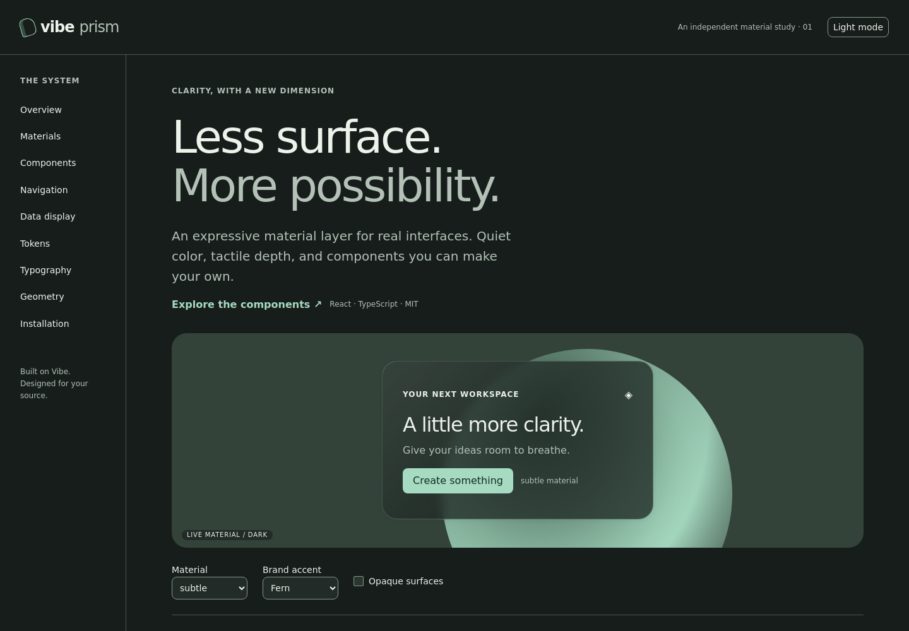

# Prism architecture and API

## Architecture

`@vibe/style/src/prism.scss` is the sole token definition and material stylesheet. It compiles through the existing Sass pipeline and is included in `@vibe/core/tokens` by the existing Rollup copy step. No runtime style injection or extra dependency is introduced by Prism. Existing CSS Modules consume an adapter from Prism semantic tokens to the established Vibe names.

`@vibe/core/src/prism/index.tsx` exports `PrismTheme`, `GlassSurface` and their prop types. Native div composition and `forwardRef` work on the existing React >=16.9 contract. The existing `classnames` utility handles class composition; there is no Tailwind class-merging requirement. Vibe’s existing typed variants (`kind`, `size`, `color`) are retained rather than adding CVA to duplicate them.

## Theme

| Prop                     | Default | Meaning                                                       |
| ------------------------ | ------- | ------------------------------------------------------------- |
| `mode`                   | `light` | Controlled `light` / `dark` scope                             |
| `transparency`           | `full`  | `reduced` forces opaque surfaces and removes backdrop filters |
| native div props and ref | —       | Class, style, aria and event composition                      |

No automatic system-mode detection or persistence is assumed. An application can store its preference and pass it as `mode`; server-render the same initial choice to avoid hydration mismatch.

Theme values inherit through the DOM. For portaled content, use the existing component’s `container` / portal-target API to put it inside the theme scope, as the showcase does with Modal. Alternatively put `data-vibe-prism="dark"` on the application’s root HTML element so body portals inherit tokens. Do not expect CSS inheritance to cross a portal mounted outside the scope. Check positioning when choosing a portal container.

## Token contract

All names below use the prefix `--prism-`.

| Family          | Tokens                                                                                                                                                                                                                                                     |
| --------------- | ---------------------------------------------------------------------------------------------------------------------------------------------------------------------------------------------------------------------------------------------------------- |
| Semantic colors | `background`, `foreground`, `surface`, `surface-elevated`, `card`, `popover`, `primary`, `primary-hover`, `primary-foreground`, `secondary`, `muted`, `muted-foreground`, `accent`, `border`, `input`, `ring`, `success`, `warning`, `destructive`, `info` |
| Typography      | `font-sans`, `font-mono`; `text-xs`, `text-sm`, `text-base`, `text-lg`, `text-xl`, `text-display`; `weight-normal`, `weight-medium`, `weight-bold`; `leading-body`, `leading-heading`; `tracking-heading`, `tracking-label`                                |
| Spacing         | `space-1`, `space-2`, `space-3`, `space-4`, `space-6`, `space-8`, `space-12`, `space-16`                                                                                                                                                                   |
| Geometry        | `radius-sm`, `radius-md`, `radius-lg`; `shadow-sm`, `shadow-md`, `shadow-lg`                                                                                                                                                                               |
| Layers          | `z-sticky`, `z-overlay`, `z-toast` for new compositions; existing Vibe layer management is preserved                                                                                                                                                       |
| Motion          | `duration-fast`, `duration-normal`, `ease`                                                                                                                                                                                                                 |
| Material        | `glass-tint` and `glass-edge` (comma-separated RGB channels), `glass-opacity`, `glass-border-opacity`, `glass-highlight`, `glass-blur`, `glass-saturation`                                                                                                 |

Semantic colors use complete CSS colors; glass channels use `255, 254, 250` for broad RGBA compatibility. Internal `--prism-material-opacity`, `--prism-material-blur`, `--prism-material-highlight` values are private material implementation details. Radii and font bridges update existing Vibe components; legacy spacing and semantic hover families remain compatible and will be consolidated gradually.

## Materials

`<GlassSurface material="subtle" />` accepts native div props and a div ref. It does not add padding, roles, click behavior, overflow clipping or focusability. Compose semantic content inside it. Do not use a clickable div as a substitute for a button.

| Material     | Purpose                                                                        |
| ------------ | ------------------------------------------------------------------------------ |
| `clear`      | Minimal diffusion and light fill, over a calm background                       |
| `subtle`     | Default for secondary containers                                               |
| `frosted`    | Higher opacity and diffusion for readable overlays                             |
| `liquid`     | Layered highlight, tinted fill, luminous edge and deeper shadow                |
| `refractive` | Reserved opt-in API; currently the liquid fallback, without optical distortion |

The baseline is an opaque card. An `@supports` block enables tinted gradients and backdrop filtering only where supported. Reduced transparency and forced colors remove optical effects. Reduced motion shortens scoped motion and suppresses repeating animations. There are no continuous animation loops.

True refraction is intentionally deferred: SVG displacement of a backdrop is inconsistent across browsers, and introducing Canvas/WebGL to ordinary controls adds cost without a demonstrated functional gain. No misleading intensity control is exposed for an absent engine.

## Migration and ownership

Existing exports and component props remain intact. TabPanel adds optional `aria-labelledby`; tabs track focused descendants without activating the wrong panel, and TextField no longer emits empty `role` attributes. Prism is opt-in, so existing applications retain their current style until wrapped in `PrismTheme`. New exports are available from `@vibe/core`; there is no separate subpath or new package. Remove the wrapper to return to the existing theme.

The showcase uses actual Button, TextField, Checkbox, Toggle, TabsContext and Modal components. Its data table is a native semantic HTML composition, not a replacement API for Vibe’s Table. Settings state is demonstration-local and is not persisted or sent to a server.

## Quality constraints

Verify contrast against the final background at each theme and brand choice. Use opaque/frosted materials for dense or important information. Check mobile GPUs before stacking blurred containers. Test keyboard operation, Escape, focus restoration, zoom, RTL, reduced motion, reduced transparency and forced colors. Jest-axe cannot validate real rendered backdrop contrast; browser review remains required.

## Verified preview

