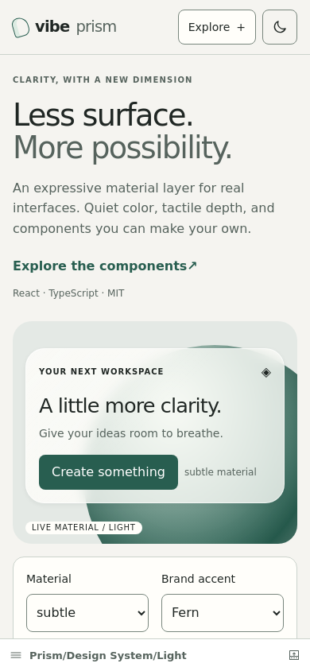
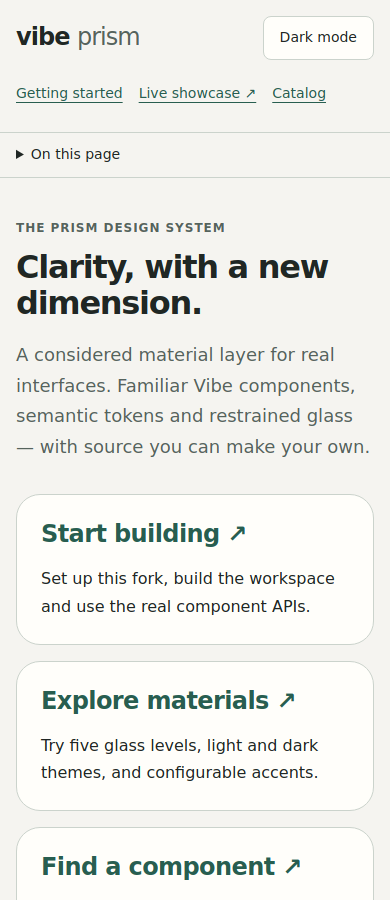

# Verification record

Run against this milestone on 2026-10-18. Environment: Node 24.19.0, Yarn Classic 1.22.22, React 16.14 and local Chromium 131 (Playwright 1.49.1). The repository’s intended development Node version remains 20.12. No packages were published. The showcase is now deployed on GitHub Pages; see the mobile follow-up below.

## Baseline and existing blockers

Initial core test, lint and build attempts failed with missing executables because this fresh environment had no installed dependencies or Yarn shim. After a frozen-lockfile installation, checks ran locally. The lockfile is unchanged. Installation scripts were initially skipped, then the actual dependency builds were run explicitly.

A detached checkout of original commit `3392aa5ef` was typechecked using the same installed dependencies. Original docs produced **559 TypeScript diagnostics**. Current full docs typecheck produces **324 diagnostics**, all present in the baseline comparison (0 new diagnostics; 235 eliminated by the Sass module declaration). Remaining failures include old Storybook interaction APIs, missing asset declarations and legacy DOM properties. These are not hidden or counted as a passing whole-docs check. The focused Prism typecheck passes.

The first static Storybook build exhausted Node’s default 2 GB heap. Re-running with `NODE_OPTIONS=--max-old-space-size=6144` succeeded. The initial dev-server attempt hit this container’s `uv_interface_addresses` restriction; browser QA used the actual production Storybook output served over a local Python HTTP server instead. That initial browser check used local output; subsequent Pages deployments are recorded below.

## Executed checks

| Check                                                       | Actual result                                             |
| ----------------------------------------------------------- | --------------------------------------------------------- |
| Frozen Yarn install, without changing dependencies          | Pass                                                      |
| `SKIP_RELEASE_ARTIFACTS=true yarn build:package @vibe/core` | Pass, 64 dependency projects                              |
| Rebuild final a11y, tabs, text-inputs and core packages     | Pass, 4 projects                                          |
| `vibe-storybook-components` build                           | Pass                                                      |
| Static Storybook production build, 6 GB heap                | Pass                                                      |
| Core Vitest suite                                           | 7 files, **62 tests passed**, including 4 new Prism tests |
| Showcase Vitest suite                                       | 1 file, **6 tests passed**                                |
| Grid keyboard-navigation helper/hook tests                  | 2 files, **46 tests passed**                              |
| Tabs full suite, final run without snapshot updating        | 6 files, **33 tests passed**                              |
| TextField suite, final run without snapshot updating        | 3 files, **65 tests passed**                              |
| Prism TypeScript check                                      | Pass                                                      |
| Full docs TypeScript check                                  | Fails: 324 baseline diagnostics, 0 new diagnostics        |
| Core ESLint                                                 | Pass, 5 existing warnings                                 |
| Tabs ESLint                                                 | Pass, 1 existing hook dependency warning                  |
| a11y and text-inputs ESLint                                 | Pass                                                      |
| New docs/Prism ESLint                                       | Pass                                                      |
| Prism material stylelint                                    | Pass                                                      |
| Opaque token contrast script                                | **14 checks passed** in light/dark                        |
| Legacy generated token file                                 | Unchanged after fixing scoped palette extraction          |
| Diff whitespace and browser script syntax                   | Pass                                                      |

Total executed unit/interaction tests listed above: **212 passed**. Tests do not rely on Chromatic. The 11 Tabs snapshots were reviewed and updated only for the added focus handler; 23 TextField snapshots were reviewed and updated for omission of empty role attributes. Subsequent runs passed without `-u`.

## Browser and visual review

The local script `node scripts/prism-browser-check.cjs` opens the built Storybook stories at 390, 768 and 1440 px in light and dark modes, with reduced motion. It blocks external asset requests so screenshots use Prism’s actual system font stack consistently. It checks horizontal overflow, WCAG-tagged axe rules and runtime errors, and captures local screenshots. It also exercises the opaque material override and Modal Escape/focus restoration.

Browser result: **all 6 mode/viewport scenarios passed**, with no horizontal overflow, WCAG-tagged axe violations or runtime errors. Dialogs fit inside each viewport; Escape restored focus to the trigger. The explicit reduced-transparency override produced `backdrop-filter: none`. Screenshots were reviewed in light and dark modes.

A real mobile overflow in Tabs and inherited global code styling were found during this process and corrected. These checks are current screenshots and interaction assertions, not established pixel-diff regression baselines. Axe does not certify contrast over arbitrary glass backgrounds.

## Skipped or deferred

- Chromatic publishing now succeeds with the updated GitHub secret on security PR #4 (build 5). This is separate from mobile screenshot QA; no Chromatic baseline comparison for these mobile changes is claimed.
- Entire 68-workspace test suite, mobile device/GPU benchmarks, Safari/Firefox and React version matrix: not executed.
- Full license/SBOM audit of transitive dependencies: not represented as complete. No new runtime dependency was added; existing license notices are preserved.
- Genuine SVG/Canvas/WebGL refraction: not implemented; the named material uses a documented liquid fallback.
- Individual visual and behavior certification of all 57 component packages: remaining milestone work.

The inherited all-component Storybook still emits large-chunk warnings (including a roughly 5.3 MB uncompressed preview chunk). Lazy-loading the upstream live editor/playground and splitting the reference docs are recommended before treating documentation bundle performance as finished.

## Mobile Pages follow-up — 2026-10-18

The existing Storybook manager and Prism showcase were adapted together: a compact mobile header, 44 px touch targets, 16 px native selects, a bounded navigation disclosure, restrained typography and a smaller material stage. The manager toolbar is hidden below 600 px while the bottom Storybook navigation remains available. Desktop sidebar sizing no longer forces a reload on phones.

Keyboard navigation closes the disclosure with Escape and restores focus. Internal anchors explicitly target the current frame because Storybook supplies a `_parent` base target. Sticky-header scroll offsets keep headings visible. The horizontally scrollable inventory has a named, focusable region with a visible focus outline.

The browser script now covers 320, 390, 430, 768 and 1440 px in both modes, plus full-manager mobile interaction checks at 320, 390 and 430 px. Run it against a production build served at `http://127.0.0.1:7008`, or set `PRISM_STORYBOOK_URL`.

Final follow-up results: all **10 light/dark viewport scenarios**, **3 mobile-manager scenarios**, opaque fallback and modal focus checks passed. Focused showcase tests: **6 passed**; Prism TypeScript, ESLint, recommended SCSS stylelint (with the repository's descending-specificity exception), production Storybook build, script syntax and diff whitespace checks passed. Existing production chunk-size warnings remain. Safari/Firefox and real mobile hardware were not tested.

## Shared documentation follow-up — 2026-10-18

Welcome and Getting Started now describe the independent Prism fork and its actual source-based setup. Existing MDX pages share a responsive token-based shell with theme controls, explicit documentation links, a keyboard-operable native table of contents and fork-specific footer. The old 640 px minimum content width no longer applies. Code wraps within the available width while keeping Storybook's Copy control; syntax colors use semantic tokens. The Catalog's Tipseen example now allows viewport-aware flipping/shifting and hides when its reference is outside view.

Executed against the final production output:

- `node scripts/prism-docs-browser-check.cjs`: **28 route/viewport checks passed** (Welcome, Getting Started, Catalog, MCP, Changelog, Migration Guide and Contributing at 320, 390, 768 and 1440 px), no page overflow or runtime errors; code-width assertions passed.
- Welcome and Getting Started: **16 light/dark WCAG-tagged axe scans passed**. This does not certify every inherited component example or arbitrary custom theme.
- Native table-of-contents anchor navigation and full mobile Storybook Welcome → Getting Started navigation passed.
- Existing showcase browser suite: **10 light/dark viewport checks and 3 mobile manager checks passed**, plus opaque fallback and modal focus restoration.
- Focused Prism tests: **6 passed**. Prism TypeScript, Prism ESLint, recommended SCSS stylelint and production Storybook build passed. Existing chunk-size warnings remain.
- Direct lint of the inherited Tipseen description still reports its two unchanged import-dependency classifications (React and Floating UI); no dependency was added. The edited behavior passes lint with that existing rule excluded.

Safari/Firefox, real mobile devices, a full inherited-docs accessibility audit and remote Chromatic comparison of this follow-up were not executed. The prior full-docs TypeScript baseline remains separate from the passing focused check.

